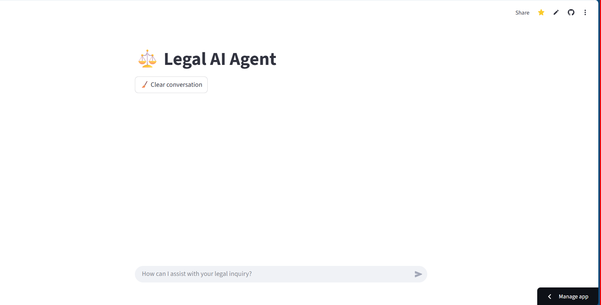

# ⚖️ Legal AI Agent

An intelligent legal assistant built with **Python** and **Streamlit**, featuring AI-powered consultation, document drafting, and jurisprudence research.  
Integrated with **Groq** for natural language processing, with Ollama Cloud and Hugging Face as optional fallbacks.

---

## Features

- **💬 Legal Chat** — Ask legal questions and get AI-driven responses with automatic case classification (labor, civil, criminal)
- **📜 Document Generator** — Draft formal contracts, powers of attorney, extrajudicial notices, and simplified petitions
- **🛡️ Jurisprudence Analysis** — Receive AI-generated analysis of potentially relevant legal theses; it does not query official court databases, and cited authorities must be independently verified
- **🌐 Multilingual** — Navigation and chat are available in Portuguese, English, and French; document and jurisprudence pages are currently in Portuguese
- **📄 Document Export** — Download generated drafts as TXT, PDF, or DOCX
- **🎨 Premium UI** — Glassmorphism design, SVG logo, dark theme, and responsive layout

---

## Tech Stack

| Technology     | Purpose                          |
|----------------|----------------------------------|
| Python         | Core language                    |
| Streamlit      | Web framework & UI               |
| OpenAI SDK     | Groq, Ollama Cloud, and Hugging Face APIs |
| Pandas         | Data handling                    |
| Plotly         | Charts & analytics               |
| python-dotenv  | Environment variable management  |

---

## Project Structure

```
Agente-IA-Juridico/
├── streamlit_app.py        # Main application (multi-page)
├── agente.py               # Local case classification logic
├── locales/                # Translation files (pt, en, fr)
│   ├── pt.json
│   ├── en.json
│   └── fr.json
├── assets/css/style.css    # Glassmorphism UI theme
├── .streamlit/
│   ├── config.toml         # Streamlit theme configuration
│   └── secrets.toml        # Secrets (gitignored)
├── tests/
│   └── test_classificacao.py  # Unit tests
├── .github/workflows/      # CI pipeline
├── requirements.txt        # Python dependencies
├── .env.example            # Reference for local config
├── .gitattributes          # Line ending normalization
└── README.md               # This file
```

---

## Quick Start

```bash
# 1. Clone the repository
git clone https://github.com/LeandroTimoteo/Legal--AI--Agent.git
cd Legal--AI--Agent

# 2. Install dependencies
pip install -r requirements.txt

# 3. Configure your API key
cp .env.example .env
# Edit .env and add a Groq API key from https://console.groq.com/keys

# 4. Run the application
streamlit run streamlit_app.py
```

---

## Configuration

Set the following environment variables in `.env` or Streamlit Cloud Secrets:

| Variable               | Description                     | Required |
|------------------------|---------------------------------|----------|
| `GROQ_API_KEY`         | Groq API key | Yes |
| `GROQ_MODEL`           | Groq model (defaults to `openai/gpt-oss-120b`) | No |

The app connects directly to Groq's OpenAI-compatible API. If `GROQ_API_KEY` is not configured, it falls back to Ollama Cloud (`OLLAMA_API_KEY`, default model `deepseek-v4.1-flash`), then Hugging Face (`HF_TOKEN`). Configure the same variable names in Streamlit Cloud Secrets when deploying. Prompts are sent to the selected provider for processing.

---

## CI Pipeline

The project includes a GitHub Actions workflow that runs on every push to `main`/`dev` and on PRs to `main`:
- Python 3.13 setup
- Dependency installation
- Pytest execution

---

## License & Disclaimer

This project is free for educational and experimental purposes.  
⚠️ The content generated by the legal agent does **not** replace professional legal advice — always consult a qualified lawyer.

---

## Author

**Leandro Timóteo Silva** — Systems Analyst

- 📧 leandrinhots6@gmail.com  
- 💼 [linkedin.com/in/leandro-timóteo-ads](https://www.linkedin.com/in/leandro-timóteo-ads)  

---

## Demo

Access the live app: [legalagent.streamlit.app](https://legalagent.streamlit.app)




 